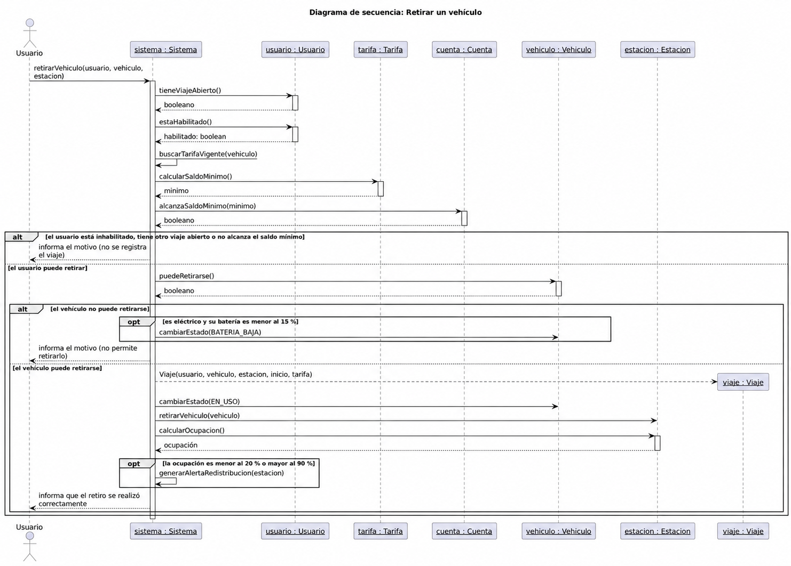
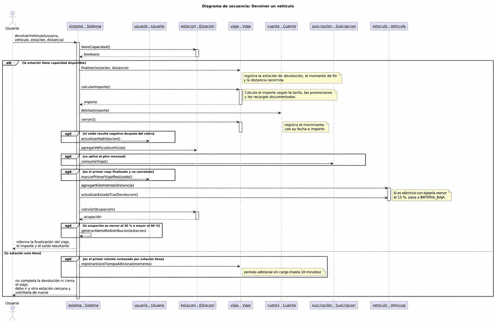

# Diagramas de secuencia

Se desarrollan Retirar un vehículo y Devolver un vehículo. El actor es el usuario. El objeto sistema : Sistema recibe las peticiones y coordina los objetos del dominio. Los nombres de instancias se subrayan; las llamadas son continuas y los retornos discontinuos.

## Retirar un vehículo

### Qué muestra

Sistema consulta tieneViajeAbierto() y estaHabilitado() en Usuario. Obtiene la tarifa vigente, pide calcularSaldoMinimo() a Tarifa y consulta alcanzaSaldoMinimo(minimo) en Cuenta.

Si el usuario cumple las condiciones, consulta puedeRetirarse() en Vehiculo. Si el retiro es válido, crea el viaje con usuario, vehículo, estación, inicio y tarifa. Cambia el estado a EN_USO, solicita retirarVehiculo(vehiculo) a Estacion y calcula su ocupación. Si queda por debajo del 20 % o por encima del 90 %, genera la alerta. Finalmente informa el resultado.

### Flujos alternativos o de error

- Si el usuario está inhabilitado, tiene otro viaje abierto o no alcanza el saldo mínimo, no se crea el viaje ni se retira el vehículo.
- Si puedeRetirarse() devuelve falso, el retiro se rechaza. La consulta contempla disponibilidad, mantenimiento obligatorio pendiente, pérdida registrada y batería de las variantes eléctricas.
- Si corresponde batería baja, se registra BATERIA_BAJA y no se permite el retiro.

### Fragmentos utilizados

- alt: usuario que no cumple las condiciones / usuario que puede retirar.
- alt: vehículo que no puede retirarse / vehículo que puede retirarse.
- opt: registro de batería baja cuando corresponde.
- opt: alerta de redistribución según ocupación.

### Relación con el diagrama de clases

Participan Sistema, Usuario, Tarifa, Cuenta, Vehiculo, Estacion y el nuevo Viaje. Las consultas figuran en sus clases receptoras. Las variantes eléctricas sobrescriben puedeRetirarse(). El viaje se crea después de las validaciones, nunca en las ramas de rechazo.

El registro posterior de puntos del recorrido está descrito en el caso de uso. Esta secuencia se limita a la solicitud y confirmación del retiro.

## Devolver un vehículo

### Qué muestra

Sistema recibe usuario, vehículo, estación y distancia. Consulta tieneCapacidad() en Estacion. Si hay lugar, Viaje.finalizar(estacion, distancia) registra los datos de fin necesarios para el cálculo; calcularImporte() obtiene el importe con las tarifas, promociones, recargos y períodos sin cargo documentados.

Después solicita Cuenta.debitar(importe), que registra el movimiento, y Viaje.cerrar(), que deja el viaje cerrado. Si el saldo queda negativo, actualiza la habilitación. La estación incorpora el vehículo. Si se aplicó el plan mensual, se consume un viaje de la suscripción; también se registra el primer viaje realizado cuando corresponde.

El vehículo acumula la distancia mediante agregarKilometros(distancia) y actualiza su estado con actualizarEstadoTrasDevolucion(). Se calcula la ocupación de la estación y se genera la alerta cuando corresponde. Se informa el importe y el saldo resultante.

### Flujo alternativo

Si la estación está llena, no se completa la devolución ni se cierra el viaje. Solo en el primer intento rechazado por ese motivo se registra el comienzo del período adicional de hasta 10 minutos sin cargo. El usuario debe ir a otra estación cercana y solicitar nuevamente la devolución.

### Fragmentos utilizados

- alt: estación con capacidad / estación llena.
- opt: actualización de habilitación por saldo negativo.
- opt: consumo de un viaje del plan mensual aplicado.
- opt: registro del primer viaje realizado.
- opt: alerta según ocupación.
- opt: inicio del tiempo adicional solo en el primer rechazo por estación llena.

### Relación con el diagrama de clases

Participan Sistema, Usuario, Estacion, Viaje, Cuenta, Suscripcion y Vehiculo. Las operaciones finalizar(destino, distancia), calcularImporte(), cerrar(), debitar(importe), agregarKilometros(distancia) y actualizarEstadoTrasDevolucion() figuran en las clases receptoras.

Separar el registro de datos de fin del cierre es una decisión de diseño: permite calcular y cobrar antes de dejar el viaje cerrado. No permite modificar después un viaje cerrado. La distancia es un dato recibido por la operación; no se presupone una conexión con GPS ni un algoritmo de medición no indicado en el enunciado.
